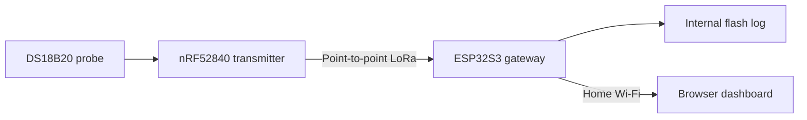

# Water Temperature Logger

A remote temperature probe, a low-power LoRa transmitter, and a Wi-Fi gateway with local logging and a browser dashboard. A project by **The Southern Bluegill**.

I’m building this to collect real water temperatures for long-term observations. The Seeed transmitter and gateway are in an initial field trial. The transmitter has been running on a 3,000 mAh battery since November 13. On November 18, it was still reporting around 3.98 V. The recharge interval is still unknown. Solar power is being tested. Automatic website reporting is running in an invitation-only production pilot.

**Current stage: initial field trial.** Seeed confirmed the fixed-channel LoRa profile is within the Wio-SX1262 DTS module grant. The antenna assembly, enclosure labeling and finished-host emissions checks are tracked in [radio status](docs/radio-status.md).

[Project journal](https://thesouthernbluegill.com/observations/projects/water-temperature-logger/) · [Get started](docs/getting-started.md) · [Wiring](docs/hardware.md) · [Status and next steps](docs/status.md)

## How it works

The **transmitter** measures the probe temperature and battery voltage, then sends a report about every 15 minutes. The **gateway** receives reports, saves them locally, and serves the dashboard over home Wi-Fi.

This is a custom point-to-point LoRa system, **not LoRaWAN and not Meshtastic**. “Gateway” describes the LoRa-to-Wi-Fi role; the Arduino filenames retain `receiver` for continuity.

## Private online reporting pilot

Owners in the pilot get a private dashboard with temperature history, time ranges, summary statistics and CSV export. Catch-up checks for readings missing from that gateway’s online history before the owner approves the upload.

The field gateway is running revision 20 in the invitation-only production pilot. Field testing confirmed that the gateway uploaded the single missing reading, showed its probe depth on the private dashboard, and resumed reporting after Wi-Fi connectivity returned.

Revision 20 firmware is publicly available. Access to online reporting is invitation-only. See the [project journal](https://thesouthernbluegill.com/observations/projects/water-temperature-logger/) for setup and pilot details.

## Choose your sketch

Use **one gateway sketch**, plus the transmitter sketch. Open the `.ino` from its matching folder; do not combine the gateway versions in the same Arduino sketch.

| Role / version | Hardware | Source |
|---|---|---|
| Gateway, **revision 20** | XIAO ESP32S3 + matching B2B Wio-SX1262, with or without an SH1106 OLED | [Revision 20 sketch](firmware/gateway/receiver_logger_pairing/receiver_logger_pairing.ino) |
| Transmitter, **revision 3** | XIAO nRF52840 + through-hole Wio-SX1262 + one DS18B20 | [Transmitter sketch](firmware/transmitter/xmiter_nrf52840/xmiter_nrf52840.ino) |

Revision 20 detects the optional SH1106 at startup. With no OLED attached, it continues logging and skips the display and its weather worker. The Rev 20 sketch uses RadioLib 7.1.2, U8g2 2.36.17, and ArduinoJson 7.4.2 for either hardware setup. Before updating an existing gateway, export its CSV, keep its partition layout, and disable **Erase All Flash Before Sketch Upload**. Rev 20 has been field-tested on the reporting gateway. No-display hardware validation is pending.

Rev 3 improves recovery from an invalid probe reading, radio errors and a boot-ID generation timeout. It retains the existing packet format and reporting cadence. Build and simulated checks passed. Hardware validation is pending.

## Current features

- Automatic transmitter ID from the board’s factory identifier; no per-unit ID editing.
- Probe temperature in °F and transmitter battery voltage.
- Home Wi-Fi setup from a phone; saved credentials reconnect after restart.
- Local dashboard with temperature, battery voltage and RSSI history, plus live SNR and sequence-gap diagnostics.
- Save CSV, clear the current log with confirmation, and browse/download archives.
- City/state or ZIP, optional water body name, measurement type, and probe depth recorded with new readings.
- Approximately **1.5 MiB of internal log storage** with the documented partition layout; SD is disabled.
- Optional SH1106 display: logo alone, centered text, short USER press toggles display; hold USER five seconds for Wi-Fi setup.

The setup hotspot has no password. The home router still requires its own password. The local HTTP dashboard is intended for a trusted network, not direct internet exposure. Read [security notes](SECURITY.md).

## Start here

1. Read [hardware and wiring](docs/hardware.md), including the separate transmitter and gateway pin maps.
2. Follow [Arduino installation, upload and Wi-Fi setup](docs/getting-started.md).
3. Save the deployment details in **Settings: location and depth** on the dashboard.
4. Check two consecutive reports and export a CSV using the [verification checklist](docs/verification.md).

For the OLED, see [display behavior and weather](docs/display.md). For the solar-light experiment, see [solar testing](docs/solar.md).

## Next experiment: collect logs during a site visit

**After validating the current build**, I want to try remote store-and-forward logging: the transmitter saves readings even when no gateway is present, then transfers its missing records when I arrive with a portable gateway. The gateway would verify and save each batch before acknowledging it; only confirmed records would be reclaimed on the transmitter.

The first attempt will use the existing boards and onboard flash, not require an SD card. Timekeeping, power use, interrupted-transfer recovery and safe acknowledgments still need design and testing. **This is planned, not in the current sketches.**

Read the [store-and-forward experiment plan](docs/store-and-forward.md). 

The [project status](docs/status.md#outdoor-battery-only-test) records the November 12 outdoor battery-only test baseline.

## What is not finished

Field calibration, installed range, all-weather reliability, battery-only current/runtime, and solar energy balance are not yet established. The transmitter has no stored backlog, acknowledgments, or resend mechanism. There is one deployment configuration per gateway, not a complete multi-probe deployment manager.

Forecast model integration is still planned. The public weather endpoints in the display build are for non-commercial bench use; a suitable service arrangement is needed before commercial rollout.

See [project status](docs/status.md), [data format and storage](docs/data.md), and [changelog](CHANGELOG.md).

## License and attribution

Original project code and documentation are provided under the [MIT License](LICENSE). Third-party libraries retain their own licenses. The logo and branding are excluded from the software license; see [NOTICE](NOTICE.md) and [asset terms](assets/LICENSE.md).
