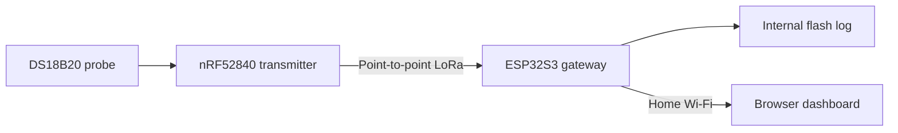

# Water Temperature Logger

A remote temperature probe, a low-power LoRa transmitter, and a Wi-Fi gateway with local logging and a browser dashboard. A project by **The Southern Bluegill**.

I’m building this to collect real water temperatures for long-term observations. The Seeed transmitter and gateway are exchanging readings on the bench. Solar power is being tested; automatic reporting to the website and model integration are planned.

**Current stage: working bench prototype, not a field-validated product.** Radio certification/integration review remains open. The radio settings in these sketches are not a declaration of FCC compliance. See [radio status](docs/radio-status.md) before operating or adapting the radio build.

[Project journal](https://thesouthernbluegill.com/observations/projects/water-temperature-logger/) · [Get started](docs/getting-started.md) · [Wiring](docs/hardware.md) · [Status and next steps](docs/status.md)

## How it works

The **transmitter** measures the probe temperature and battery voltage, then sends a report about every 15 minutes. The **gateway** receives reports, saves them locally, and serves the dashboard over home Wi-Fi. It does not currently upload readings to a cloud service.

This is a custom point-to-point LoRa system, **not LoRaWAN and not Meshtastic**. “Gateway” describes the LoRa-to-Wi-Fi role; the Arduino filenames retain `receiver` for continuity.

## Choose your sketch

Use **one gateway sketch**, plus the transmitter sketch. Open the `.ino` from its matching folder; do not combine the gateway versions in the same Arduino sketch.

| Role / version | Hardware | Source |
|---|---|---|
| Gateway **with display**, revision 8 | XIAO ESP32S3 + matching B2B Wio-SX1262 + optional 1.3-inch SH1106 | [Display sketch](firmware/gateway/display/receiver_xiao_esp32s3/receiver_xiao_esp32s3.ino) |
| Gateway **without display**, revision 6 | XIAO ESP32S3 + matching B2B Wio-SX1262 | [No-display sketch](firmware/gateway/no-display/receiver_xiao_esp32s3/receiver_xiao_esp32s3.ino) |
| Transmitter, flash sleep fix revision 2 | XIAO nRF52840 + through-hole Wio-SX1262 + one DS18B20 | [Transmitter sketch](firmware/transmitter/xmiter_nrf52840/xmiter_nrf52840.ino) |

Both gateway builds provide Wi-Fi setup, local logging, CSV export, graphs, deployment settings, and radio diagnostics. The display build adds the centered logo, continuously cycling OLED screens, and location-based time/weather. The no-display build has no OLED or weather dependencies. See [setup instructions](docs/getting-started.md) for exact board packages and library versions.

## Current features

- Automatic transmitter ID from the board’s factory identifier; no per-unit ID editing.
- Probe temperature in °F and transmitter battery voltage.
- Home Wi-Fi setup from a phone; saved credentials reconnect after restart.
- Local dashboard with temperature, battery voltage and RSSI history, plus live SNR and sequence-gap diagnostics.
- Save CSV, clear the current log with confirmation, and browse/download archives.
- City/state or ZIP, optional water body name, measurement type, and probe depth recorded with new readings.
- Approximately **1.5 MiB of internal log storage** with the documented partition layout; SD is disabled.
- Optional SH1106 display: logo alone, centered text, short USER press toggles display; hold USER five seconds for Wi-Fi setup.

The setup hotspot has no password. The home router still requires its own password. The local HTTP dashboard is intended for a trusted network, not direct internet exposure. Read [security notes](SECURITY.md).

## Start here

1. Read [hardware and wiring](docs/hardware.md), including the separate transmitter and gateway pin maps.
2. Follow [Arduino installation, upload and Wi-Fi setup](docs/getting-started.md).
3. Save the deployment details in **Settings: location and depth** on the dashboard.
4. Check two consecutive reports and export a CSV using the [verification checklist](docs/verification.md).

For the OLED, see [display behavior and weather](docs/display.md). For the solar-light experiment, see [solar testing](docs/solar.md).

## What is not finished

Field calibration, installed range, all-weather reliability, battery-only current/runtime, and solar energy balance are not yet established. The transmitter has no stored backlog, acknowledgments, or resend mechanism. There is one deployment configuration per gateway, not a complete multi-probe deployment manager.

Cloud reporting, database ingestion, and model integration are planned and disabled/not implemented in these sketches. The public weather endpoints in the display build are for non-commercial bench use; a suitable service arrangement is needed before commercial rollout.

See [project status](docs/status.md), [data format and storage](docs/data.md), and [changelog](CHANGELOG.md).

## License and attribution

Original project code and documentation are provided under the [MIT License](LICENSE). Third-party libraries retain their own licenses. The logo and branding are excluded from the software license; see [NOTICE](NOTICE.md) and [asset terms](assets/LICENSE.md).
